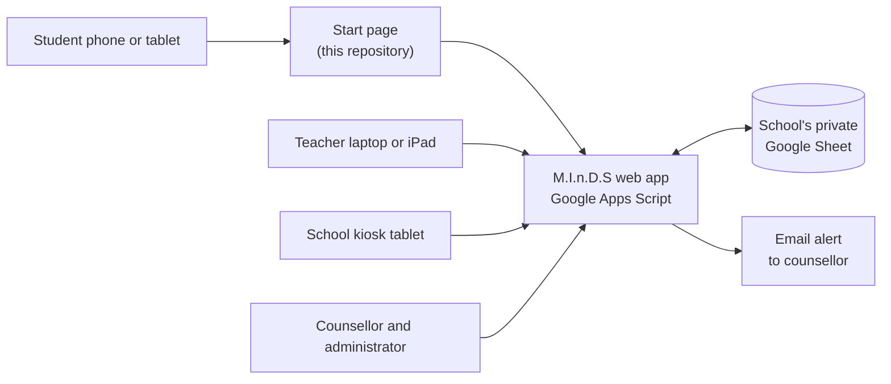
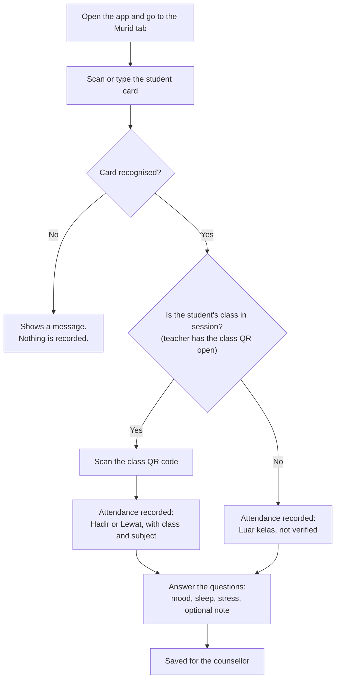
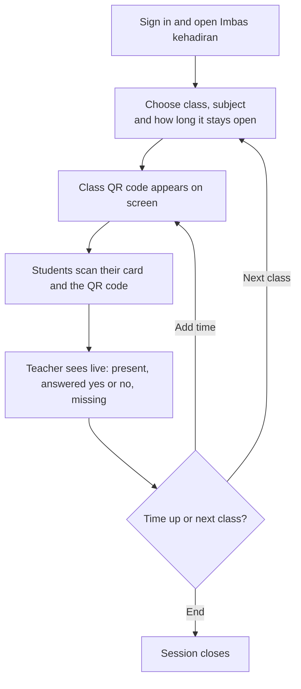
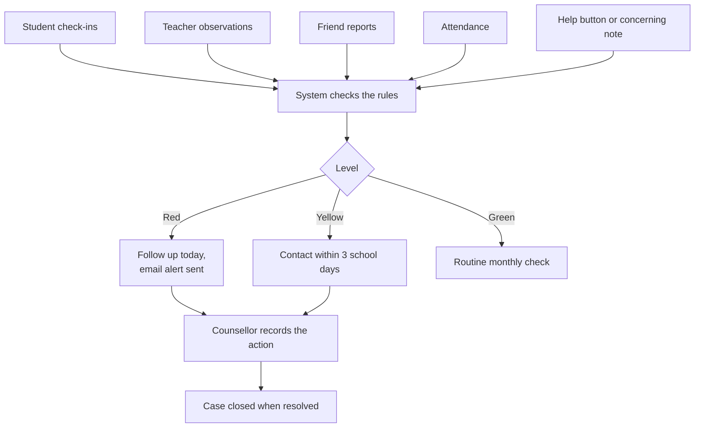

# M.I.n.D.S

**Mood Intervention and Detection for Students**

M.I.n.D.S is a student attendance and wellbeing check-in system for schools. Students check in with their student card and answer a short set of questions about how they feel. Counsellors see who may need support, and teachers see attendance only.

**Status:** being prepared for a pilot. The test copy holds fictional data only.

**Open the app:** https://abdullahafeef.github.io/minds-app/

This repository holds only the **start page** that lets the system be installed on a phone, tablet or computer. The system itself runs on Google Apps Script, and its code isn't stored here. This repository contains no student data, passwords or keys.

## Contents

- [Overview](#overview)
- [How the parts connect](#how-the-parts-connect)
- [Flowcharts](#flowcharts)
- [Setup](#setup)
- [Before using it with real students](#before-using-it-with-real-students)
- [Limits](#limits)
- [Files in this repository](#files-in-this-repository)

## Overview

### What it does

- **Check-in:** students scan their card with a phone, tablet or kiosk, then answer questions on mood, sleep and stress, with an optional note.
- **Attendance:** recorded with the time, by class and subject when the teacher runs a class QR session.
- **Getting help:** students can press "Saya ada masalah dan perlu bercakap" (I have a problem and need to talk) or report concern for a friend anonymously.
- **Counsellor dashboard:** students are marked red, yellow or green, with the reasons shown. Serious concerns send an email alert straight away.
- **Answer check:** marks patterns worth a second look, in case a student always says they are fine. It prompts a conversation and doesn't prove anything.
- **Student cards:** printed with a QR code, a barcode, or both.
- **Languages and display:** Bahasa Melayu and English, in light and dark mode.

### Who sees what

| Role | Sign-in | Can see and do |
|---|---|---|
| Student | Card only | Their own check-in screen |
| Teacher | Username and password | Class and subject attendance, class QR, observation form. **No wellbeing answers.** |
| Counsellor | Username and password | Dashboard, cases, attendance, observations, printing cards, exports |
| Administrator (IT) | Username and password | Everything, plus students, users, settings, audit log and data retention |
| Kiosk | Secret link for each device | Records scans and check-ins only |
| Public view | None | Anonymous totals only, if the administrator switches it on |

## How the parts connect

- Each school runs its **own copy**, with its own link and its own Google Sheet.
- The start page only opens the system. It stores no answers, and it isn't needed if someone opens the system link directly.
- Staff and students use the web app and never need access to the Google Sheet.

## Flowcharts

### Student check-in

- **Kiosk devices:** the student scans their card, attendance is recorded, and the questions open. No class QR is needed.
- **Luar kelas (outside class):** a card number alone doesn't prove who someone is. So these answers are marked as not verified, the student sees only a first name, and a later verified scan still counts. An administrator can switch this off in **Tetapan**, and the class QR is then always required.

### Teacher class session

### Counsellor follow-up

The system only raises the alert. The school must decide who responds, and how quickly.

## Setup

### Part 1: Set up the system on Google Apps Script (about 20 minutes)

You need a Google account for the school, ideally DELIMa or Google Workspace. **Whoever installs it owns the data**, so use a school account rather than a personal one. The system's files come from the project team's template or setup kit.

1. **Get a copy** of the template, then open it and go to **Extensions → Apps Script**.
2. **Run `setup`:** choose `setup` in the function menu, click **Run**, and allow the permissions. Keep the **setup code** shown in the Execution log.
3. **Deploy:** click **Deploy → New deployment → Web app**. Set **Execute as** to **Me** and **Who has access** to **Anyone**, then copy the web app link.
4. **Create the first administrator:** open the link and enter the setup code, your name, a username and a password.
5. **Enter school details:** in **Tetapan / Settings**, set the school name, counsellor name, late time and alert emails.
6. **Add students:** in **Import & eksport**, download the template, fill it in and upload it.
   - **CardID** must be exactly what the card's code contains, which is often not the number printed on the card.
   - **Never use IC or MyKid numbers.**
7. **Add staff:** in **Pengguna / Users**, each new user gets a temporary password, shown once. Save an email for each counsellor and teacher, so **Lupa kata laluan** (Forgot password) can send them a code. Without one, the request goes to the administrator.
8. **Print student cards** if needed: **Murid → Cetak kad**, printed at 100% scale.
9. **Add kiosks** if the school uses them: **Kiosk → Tambah kiosk**.

To update the system later, use **Deploy → Manage deployments → Edit → New version**. This keeps the same link.

### Part 2: Set up this start page (optional)

Skip this if a home-screen shortcut to the system link is enough. The start page adds a short address, the M.I.n.D.S icon and an offline message.

1. Copy this repository to your own GitHub account.
2. In `config.js`, replace the link with your school's web app link from Part 1.
3. Publish it using either option:
   - **GitHub Pages:** go to **Settings → Pages → Deploy from a branch → main → /(root)**. The repository must be public on a free GitHub plan.
   - **Cloudflare:** create a Worker connected to the repository. `wrangler.jsonc` already holds the settings, and the name in that file must match your Worker's name.

Devices that already installed the app pick up a changed link the next time they open it online. The QR code on the page always follows the page's own address.

### Part 3: Install on a device

Open the start page, then:

| Device | Steps |
|---|---|
| **Android (Chrome)** | Tap **Pasang aplikasi**, or use the **⋮** menu and choose **Install app** or **Add to Home screen** |
| **iPhone or iPad (Safari)** | Tap **Share**, then **Add to Home Screen**, then **Add** |
| **Computer (Chrome or Edge)** | Click the install icon in the address bar |

If the option doesn't appear, open the link in Chrome or Safari rather than inside WhatsApp or Telegram.

## Before using it with real students

- Get approval from the principal and JPN.
- Send parents a consent form and a privacy notice in Malay.
- Agree in writing who responds to red flags, how quickly, and what happens after school hours.
- Agree how long records are kept. **Import & eksport → Simpanan data** deletes older records.
- Remove any sample data, and keep the Google Sheet private to its IT owner.
- Test on real phones, with a real class QR session, on the school's Wi-Fi.

## Limits

- **Size:** suits one school of up to about 2,000 students.
- **Many users at once:** about 30 requests can run at the same moment, so a very large group scanning in the same few seconds may see a short "try again".
- **Internet:** needed for everything. Nothing works offline except the start page's message.
- **Email alerts:** Google allows about 100 a day on a personal account and 1,500 on Workspace.
- **Google's notice:** Google shows "This application was created by a Google Apps Script user" at the top of the system. Anyone can close it with the **X**, but it comes back on later visits.
- **Self-reported answers:** the system can't tell whether a student is being honest. It supports counsellors and teachers and doesn't replace them.

## Files in this repository

| File | Purpose |
|---|---|
| `index.html` | The start page: install steps, language switch, offline message |
| `config.js` | The link to the school's system. **The one file to change.** |
| `manifest.webmanifest` | App name, icons and colours used when installing |
| `sw.js` | Keeps the start page available offline |
| `icons/` | App icons and logo |
| `lib/qrcode.min.js` | Draws the QR code on the page ([qrcodejs](https://github.com/davidshimjs/qrcodejs)) |
| `wrangler.jsonc`, `.assetsignore` | Cloudflare settings: what to publish, and what to leave out |
